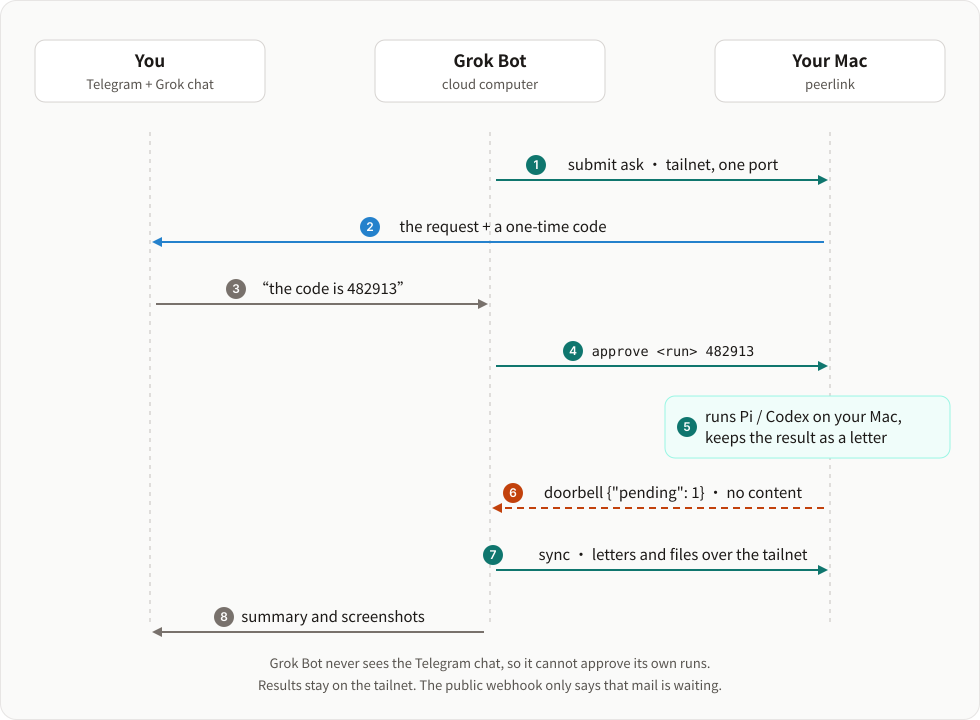

# peerlink

English | [简体中文](README.zh-CN.md)

**Give Grok Bot hands on your Mac, without giving it the keys.**

peerlink is built for Grok Bot. Grok Bot lives on a cloud computer: it can research, plan and talk to you, but it cannot open an app on your Mac, use your logins or look at your screen. peerlink lets it run the tasks *you* wrote down, on your Mac, over Tailscale. Anything free-form waits for a one-time code on your Telegram. When a run finishes, a doorbell wakes Grok Bot, which fetches the result and tells you.

<p align="center"></p>

## Why peerlink

Three problems come up as soon as a cloud agent should do something on your own computer.

| Problem | What peerlink does |
|---|---|
| **A shell gives away everything.** With SSH, a confused or prompt-injected agent can do anything you can do. | **The catalog is the scope.** Grok Bot can only start tasks in `~/.peerlink/tasks`, with parameters checked against a schema. The tailnet ACL lets its tag reach only peerlink's port, and every request is identified with `tailscale whois`. |
| **Some jobs need a human yes.** Not everything can be written as a script in advance. | **Approval on Telegram.** A task with `approve = true` waits until you give Grok Bot the 6-digit code that peerlink sent to your Telegram. Grok Bot never sees that chat, so it cannot approve itself. Each follow-up message to such a run needs a new code. |
| **Grok Bot sleeps.** Its computer keeps no process running, so nothing is there to receive a result that arrives an hour later. | **A doorbell.** peerlink keeps the result as a letter and calls Grok Bot's [routine webhook](https://cursor.com/help/grok-bot/routines) with only `{"from", "pending"}`. Grok Bot wakes up, fetches the letter over the tailnet, and tells you. A leaked webhook URL can only wake Grok Bot; it reveals no result. |

## What you get

- **An audit log.** Every submit, approval request, approval, run, letter, doorbell ring and refused request is recorded in SQLite. `peerlink log` shows it.
- **Caller text never reaches the prompt.** Parameters and free text go into the run's `request.json`. The agent gets the path and is told to treat the content as data.
- **Letters that wait.** A result stays until Grok Bot acknowledges it, up to 7 days. The doorbell merges letters within 10 minutes and rings again after 1 h, 3 h and 9 h if nobody came.
- **Files come back through peerlink.** A run puts screenshots or logs in `out/`. Grok Bot downloads them from the same port and checks their sha256.
- **Agents that ask back.** A Pi or Codex task can ask a question. Grok Bot relays it to you, and your answer resumes the same session.
- **Nothing a run starts outlives it.** When a turn ends, peerlink kills the processes the run left behind.
- **Brakes.** Daily submit caps, concurrency limits, resource locks, per-day dedupe, timeouts, and `peerlink stop --all`.
- **Small.** One Python process (standard library, 3.11+), one port, one SQLite file, plus the `tailscale` CLI.

## A day with Grok Bot

| When | What happens |
|---|---|
| Morning | A scheduled Grok Bot routine submits a script task with `dedupe = "per-day"`, so a retried routine does not run it twice. The run finishes, the doorbell rings, and Grok Bot sends you the result in chat. |
| Afternoon | You ask Grok Bot to look into something on your Mac. It submits the free-form `ask` task. Your Telegram shows the request and a code. You tell Grok Bot the code, and Codex starts on your Mac. |
| An hour later | The run saves a screenshot to `out/`. The doorbell wakes Grok Bot, which runs `peerlink sync`, then sends you a summary and the screenshot. |
| Any time | If the agent on your Mac asks a question, Grok Bot passes it on. Your answer goes back as a follow-up, which waits for a new code. |

**In daily use.** Between 2026-10-12 and 2026-11-03, one Grok Bot submitted a scheduled script task on 20 days, got 7 free-form runs approved on Telegram, received 36 doorbell rings and downloaded 65 files from runs. Any agent that can run Python and reach your tailnet can use peerlink the same way; Grok Bot is the one it was built and tested with.

## How it works

```
Grok Bot (tag:agent)                         your Mac
┌──────────────────────┐   tailnet, one port  ┌──────────────────────────────────────┐
│ peerlink.pyz submit  │ ───────────────────► │ peerlink serve                       │
│ peerlink.pyz sync    │ ◄─────────────────── │  ├ identity: tailscale whois         │
└──────────▲───────────┘                      │  ├ catalog: ~/.peerlink/tasks/*      │
           │ webhook: {"from": …, "pending": N}│  ├ runs: script | pi | codex         │
           └──────────────────────────────────┤  └ letters until acknowledged        │
                                              └──────────────────────────────────────┘
```

1. **Identity.** Every request is mapped to a principal with `tailscale whois`: loopback and your own logins are `owner`; tagged nodes map to the principals you configure; everyone else gets 403. Anything a caller says about itself is ignored.
2. **Catalog.** Each task is a directory with a `task.toml`. Callers pick a task by name and pass parameters, which are validated against the task's schema. The catalog is hot-reloaded.
3. **Runs.** A run gets its own directory with `request.json`. Script tasks run the task's own program. Agent tasks run Pi or Codex with a prompt that contains the runbook and the *path* to `request.json` — the caller's text never goes into the prompt.
4. **Letters.** When a run finishes (or an agent has a question), peerlink stores a letter for the caller and keeps it until the caller acknowledges it (up to 7 days).
5. **Doorbell.** If the caller has a webhook configured, peerlink calls it with only `{"from": "<node>", "pending": N}` — no content. New letters ring at once but at most once per 10 minutes; unfetched letters ring again after 1 h, 3 h and 9 h.

## What has been verified

| Area | Status |
|---|---|
| Grok Bot's cloud computer to a Mac over Tailscale | In daily use since 2026-10-12. Grok Bot runs `tailscaled` in userspace mode from `/workspace`. |
| Telegram approval | In daily use. Approval of follow-up messages is covered by tests; Grok Bot has not sent an approved follow-up yet. |
| Agent tasks | Codex and Pi runs from Grok Bot have succeeded. |
| Platforms | The node has only been used on macOS. The test suite runs on Ubuntu and macOS with Python 3.11 and 3.13. |
| Security | No independent security audit. |

peerlink is not a sandbox: Pi and Codex tasks run with your permissions (see below). It is also not a chat bus between agents: a caller starts tasks from your catalog and gets letters back.

## Security model

Read this before exposing anything.

- **The tailnet ACL is the first wall.** Give the remote agent's node a tag and allow that tag to reach only this computer's peerlink port.
- **The catalog is the scope.** Callers can only run what is in `~/.peerlink/tasks`. Writing or editing a task is the approval step; keep the catalog in its own git repository so its history shows every change in what callers may do.
- **Agent tasks are not sandboxed.** A `pi` / `codex` task runs with the settings, permissions and login of the user running peerlink. A runbook's "do not" is a request, not a limit. Prefer a script task for anything that can be written down in advance, and gate free-form tasks like `examples/tasks/ask` with `approve = true`.
- **Owner approval.** A task with `approve = true` does not run when a remote caller submits it. peerlink sends the request and a one-time 6-digit code to your Telegram; the caller can start the run only with that code, which you give it when you agree. The code is bound to the run, expires after `approval_ttl`, and 5 wrong tries cancel the run. A follow-up message (`msg`) from a remote caller is a new instruction, so it waits the same way: its full text and a new code go to Telegram, and the turn starts only with that code. If the follow-up expires or gets 5 wrong codes, only the follow-up is dropped; the run returns to its previous state and the caller gets a `note` letter. Since the caller never sees the Telegram chat, a confused or hijacked agent cannot approve itself.
- **Files go back through peerlink.** A run returns files by putting them in `out/`; callers download them from the same port. Tasks never need to open ports or start servers to share something.
- **Nothing a run starts outlives it.** When a turn ends, peerlink kills what the run left behind: every process in the run's session (`nohup`, `&`) and every process carrying its `PEERLINK_RUN_ID` (which survives `setsid`), with their children. A process that leaves the session and also clears its environment (or is an Apple platform binary such as `/bin/sh`, whose environment macOS hides) is not found.
- **No browsers.** Loopback is the owner, so requests with browser headers (`Origin`, `Sec-Fetch-Site`), POSTs that are not `application/json`, and unknown `Host` names are refused. A web page open on your Mac cannot submit tasks.
- **Caller input is data.** Parameters are schema-checked; free text is written to `request.json` and the prompt tells the agent to treat it as data.
- **Secrets stay in shell env files.** Webhook URLs and tokens live in a `chmod 600` env file that is only `source`d by a shell; peerlink never reads it into Python or logs it, and the token reaches `curl` on stdin.
- **Everything is logged.** The audit log in `~/.peerlink/peerlink.db` records who did what and when, including refused requests. Read it with `peerlink log`.
- **Limits and brakes.** Per-principal daily caps, concurrency limits, per-task timeouts, and `peerlink stop --all` (cancel everything and refuse new work until `peerlink resume`).

## Install (macOS)

```bash
git clone https://github.com/jokerlin/peerlink ~/peerlink
mkdir -p ~/.peerlink/tasks && chmod 700 ~/.peerlink
cp ~/peerlink/deploy/config.example.toml ~/.peerlink/config.toml && chmod 600 ~/.peerlink/config.toml
$EDITOR ~/.peerlink/config.toml        # your tailnet IP, your login, the remote agent's tag

# a convenience wrapper for the CLI
mkdir -p ~/.local/bin
printf '#!/bin/sh\nPYTHONPATH=%s exec python3 -m peerlink "$@"\n' ~/peerlink > ~/.local/bin/peerlink
chmod +x ~/.local/bin/peerlink

# run it as a LaunchAgent in your login session
sed -e "s|__PYTHON__|$(command -v python3)|" -e "s|__REPO__|$HOME/peerlink|g" -e "s|__HOME__|$HOME|g" \
  ~/peerlink/deploy/local.peerlink.plist > ~/Library/LaunchAgents/local.peerlink.plist
launchctl bootstrap gui/$(id -u) ~/Library/LaunchAgents/local.peerlink.plist

peerlink doctor
```

It runs as a LaunchAgent rather than a system daemon so that tasks can use your login session: GUI apps, the keychain, and the Pi / Codex logins. The core is plain Python and should run elsewhere too, but it has only been used on macOS.

> On macOS, a background process that touches `~/Documents`, `~/Desktop` or `~/Downloads` triggers a privacy prompt and blocks until someone answers it. Keep anything your tasks need outside those folders.

## Configuration

`~/.peerlink/config.toml` only needs what differs from the defaults in `peerlink/config.py`; see `deploy/config.example.toml`.

| Key | Default | Meaning |
|---|---|---|
| `node` | hostname | Name shown to callers and sent in the doorbell |
| `listen` | `["127.0.0.1:8091"]` | Addresses to listen on; add your tailnet IP |
| `tasks_dir` / `work_dir` | `~/.peerlink/tasks` / `~/.peerlink/work` | Catalog and run directories |
| `max_concurrent` / `max_agent` | 4 / 2 | Concurrent runs in total / agent runs |
| `default_timeout` | `30m` | For tasks without a `timeout` |
| `letter_ttl_days` | 7 | How long unacknowledged letters are kept |
| `doorbell_window` / `doorbell_retry` | 600 / `[3600, 10800, 32400]` | Doorbell merge window and re-ring schedule (seconds) |
| `env` | `{}` | Extra environment for runs and the doorbell (e.g. a proxy) |
| `pi_bin` / `codex_bin` | `pi` / `codex` | Agent CLIs |
| `approval_telegram` / `approval_ttl` | none / 1800 | Env file with `TELEGRAM_BOT_TOKEN` and `TELEGRAM_CHAT_ID` for approval codes / how long a code is valid (seconds) |
| `principals.<name>` | `owner` only | `local`, `logins`, `tags`, `daily_submits` (0 = unlimited), `doorbell` (env file path) |

## Tasks

A task is `~/.peerlink/tasks/<name>/task.toml` plus whatever files it needs. See `examples/tasks/` (`hello` is a script task, `ask` defaults to Pi; pass `agent=codex` to select Codex).

```toml
description = "Shown to callers in GET /tasks"
kind        = "script"            # script | pi | codex
command     = ["sh", "run.sh"]    # script tasks: the program, relative to the task dir
# runbook   = "runbook.md"        # agent tasks: instructions for the agent
# cwd       = "~/somewhere"       # default: task dir (script) or run dir (agent)
timeout     = "10m"
locks       = ["app:thing"]       # runs sharing a lock queue up behind each other
dedupe      = "per-day"           # same task submitted again today -> same run (--retry reruns a failed one)
# allow     = ["grok/bot"]        # default: every principal
# enabled   = false
# approve   = true                # runs by remote callers wait for your code on Telegram
# env       = { KEY = "value" }

[params.count]                    # params are validated; unknown params are rejected
type = "integer"                  # string | integer | number | boolean
minimum = 1
maximum = 10
default = 3                       # params with a default are optional
# free-text strings need max_length; also: enum, pattern, min_length, description

[report]
on = ["finished"]                 # when to send a letter: finished | succeeded | failed
```

- **Script tasks** get `PEERLINK_RUN_ID`, `PEERLINK_RUN_DIR`, `PEERLINK_TASK`, `PEERLINK_CALLER`, `PEERLINK_REQUEST` (path to `request.json`) and `PEERLINK_PARAM_<NAME>`. The result is `$PEERLINK_RUN_DIR/result.json` and/or `result.md`, else the tail of stdout. Exit code 0 means success.
- **Agent tasks** write their answer to `result.md`. To ask the caller something they write `question.txt`; the run becomes `needs_input`, a `run.question` letter goes out, and the caller's `POST /runs/<id>/messages` resumes the same session (`pi --session <file>` / `codex exec resume`). Pi sessions are stored in each run's `session.jsonl`. Use `timeout` to limit agent runs; `max_turns` is not supported by either CLI.
- **Files for the caller** go in `$PEERLINK_RUN_DIR/out/`: regular files named with letters, digits, `.`, `_`, `-`, of type png, jpg, txt, log, md or json, up to 10 MB each and 30 MB / 50 files per run. When the turn ends they are listed (name, size, sha256) in the result and the letter, and the caller downloads them with `GET /runs/<id>/files/<name>`; a file changed after that is not served.
- `peerlink task lint [name]` checks a task; `peerlink task try <name> key=value` runs it once as a non-owner principal, using a throwaway database and sending no letters.

## Command line

On the node: `serve`, `doctor`, `task lint`, `task try`, `log`, `inbox`, `stop --all`, `resume`, `telegram-test`, `approve <run>` (no code needed on the node).
From anywhere on the tailnet (set `PEERLINK_PEER=http://<node>:8091` or pass `--peer`): `info`, `tasks`, `submit <task> k=v [--wait] [--retry]`, `status <run> [--wait]`, `runs`, `cancel <run>`, `msg <run> "text"`, `approve <run> <code>`, `fetch <run> [--dir DIR]`, `sync [--save DIR] [--no-ack]` (`--save` also downloads the letters' files to `DIR/<run>/`).

## HTTP API

| Route | Who | What |
|---|---|---|
| `GET /info` | any principal | Node name, protocol version, how to receive |
| `GET /tasks` | any principal | Tasks visible to the caller, with parameter schemas |
| `POST /runs` | any principal | `{"task", "params", "dedupe_key"?, "retry"?}` → run |
| `GET /runs`, `GET /runs/<id>` | caller's own runs (owner: all) | Run state and result |
| `POST /runs/<id>/messages` | run's caller | Answer a question / follow up |
| `POST /runs/<id>/cancel` | run's caller, owner | Cancel |
| `POST /runs/<id>/approve` | run's caller (with `{"code"}`), owner | Start a run that is `awaiting_approval` |
| `GET /runs/<id>/files/<name>` | run's caller, owner | A file the run published |
| `GET /mail`, `POST /mail/ack` | any principal | Fetch and acknowledge your letters |
| `POST /msg` | any principal | Drop a letter for the node |
| `GET /bundle.tar.gz` | any principal | Client zipapp + `SKILL.md` for remote agents |
| `POST /admin/stop`, `POST /admin/resume` | owner | Emergency stop / resume |

## Set up Grok Bot

1. In Tailscale, create a tagged auth key (e.g. `tag:agent`, ephemeral, reusable) and add a grant so that the tag can reach only this node's port:
   ```jsonc
   {"src": ["tag:agent"], "dst": ["host:<your-node>"], "ip": ["tcp:8091"]}
   ```
2. Have Grok Bot join the tailnet with that key on its cloud computer. It can run `tailscaled` in userspace mode, with its state under `/workspace`, which survives a rebuild of the computer. Do not paste the auth key into a chat you want to keep.
3. Add a principal for the tag in `config.toml` (see the example).
4. Grok Bot installs the client: `curl -s http://<node>:8091/bundle.tar.gz | tar xz -C /workspace/peerlink`. The bundle's `SKILL.md` (from `skill/SKILL.md`, with your node's name and address filled in) tells it how to submit tasks, handle approvals and read letters.
5. For the doorbell, create a Grok Bot routine with a webhook trigger. Put its URL and key in the env file named by `doorbell` (`WEBHOOK_URL=…`, `WEBHOOK_TOKEN=…`, `chmod 600`); peerlink sends the key as a Bearer token. Give the routine an instruction like this:
   ```text
   When this routine is triggered by its webhook:
   1. Make sure Tailscale is up on your computer.
   2. Run: PEERLINK_PEER=http://<node>:8091 python3 /workspace/peerlink/bin/peerlink.pyz sync --save /workspace/peerlink/inbox
   3. Handle each letter as /workspace/peerlink/SKILL.md says: send me a short summary of each run.result, and pass each run.question on to me.
   ```
6. Optional: a scheduled routine that submits a daily script task, for example `peerlink submit <task>` every morning.

## Approval codes on Telegram

1. In Telegram, talk to **@BotFather**, send `/newbot`, and pick a name and a username ending in `bot`. BotFather replies with the bot token.
2. Open a chat with your new bot and send it any message (bots cannot message you first).
3. Find your chat id: `curl -s "https://api.telegram.org/bot<TOKEN>/getUpdates"` and read `result[0].message.chat.id`.
4. Write the env file, outside git:
   ```bash
   umask 077
   printf 'TELEGRAM_BOT_TOKEN=%s\nTELEGRAM_CHAT_ID=%s\n' '<TOKEN>' '<CHAT_ID>' > ~/.peerlink/secrets/telegram.env
   ```
5. Add `approval_telegram = "~/.peerlink/secrets/telegram.env"` to `config.toml`, restart peerlink, and run `peerlink telegram-test`. If Telegram needs a proxy where you are, put it in `[env]`.

## Related

[yobiru](https://github.com/chekusu/yobiru) connects agents as peers, so that they can message each other and exchange files over Tailscale. peerlink borrowed its idea of passing caller text to an agent as data, never as instructions. Use yobiru when agents should talk to each other; use peerlink when a cloud agent should run a fixed set of jobs on your Mac under your approval.

## Development

```bash
python3 -m unittest discover -s tests
```

The tests use fake `pi` / `codex` binaries and a fake `tailscale whois`; they need no network. See [CONTRIBUTING.md](CONTRIBUTING.md) for the rules and the release steps, and [SECURITY.md](SECURITY.md) to report a vulnerability.

## License

[MIT](LICENSE)
