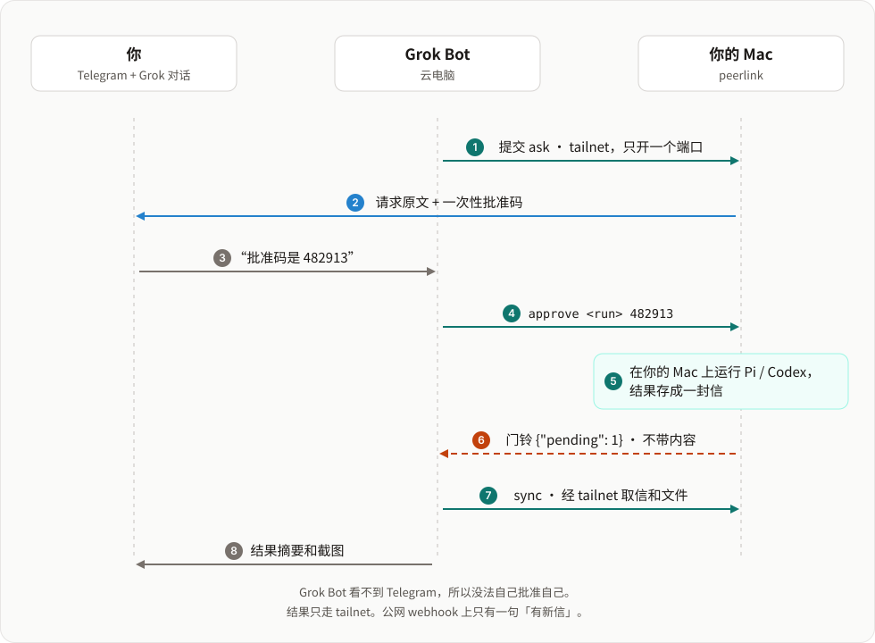

# peerlink

[English](README.md) | 简体中文

**让 Grok Bot 在你的 Mac 上动手，钥匙留在你手里。**

peerlink 是为 Grok Bot 做的。Grok Bot 住在云电脑上：它能查资料、做计划、跟你聊，但打不开你 Mac 上的应用，用不了你的登录，也看不到你的屏幕。peerlink 让它经 Tailscale 在你的 Mac 上运行*你写好的*任务。自由发挥的任务要等你 Telegram 上的一次性批准码。运行结束后，门铃把 Grok Bot 叫醒，它取回结果再告诉你。

<p align="center"></p>

## 为什么需要 peerlink

想让云端 agent 在你自己的电脑上做事，马上会碰到三个问题。

| 问题 | peerlink 的做法 |
|---|---|
| **给 shell 等于交出一切。** 有了 SSH，理解错了或被提示注入的 agent 能做你能做的任何事。 | **任务目录就是范围。** Grok Bot 只能启动 `~/.peerlink/tasks` 里的任务，参数按 schema 校验。tailnet ACL 只放行它的标签访问 peerlink 这一个端口，每个请求都用 `tailscale whois` 认身份。 |
| **有些事要人点头。** 不是所有事都能事先写成脚本。 | **Telegram 审批。** `approve = true` 的任务会一直等，直到你把 peerlink 发到你 Telegram 的 6 位批准码告诉 Grok Bot。Grok Bot 看不到那个对话，没法自己批准自己。对这类运行的每条追问都要新的批准码。 |
| **Grok Bot 会睡着。** 它的电脑上没有常驻进程，一小时后才出来的结果没人接。 | **门铃。** peerlink 把结果存成一封信，再调 Grok Bot 的 [routine webhook](https://cursor.com/help/grok-bot/routines)，请求体只有 `{"from", "pending"}`。Grok Bot 醒来，经 tailnet 取信，再告诉你。webhook 地址泄露了，别人最多把 Grok Bot 叫醒，拿不到任何结果。 |

## 你能得到什么

- **审计日志。** 每次提交、批准请求、批准、运行、信件、门铃和被拒的请求都记在 SQLite 里，用 `peerlink log` 查看。
- **发起方的文字进不了提示词。** 参数和自由文本写进运行目录的 `request.json`。agent 只拿到路径，并被要求把内容当数据。
- **信会等人来取。** 结果一直保留到 Grok Bot 确认收到，最长 7 天。10 分钟内的新信合并成一次门铃；没人来取，1 小时、3 小时、9 小时后各再响一次。
- **文件经 peerlink 回传。** 运行把截图或日志放进 `out/`，Grok Bot 从同一个端口下载，并校验 sha256。
- **agent 可以反问。** Pi 或 Codex 任务可以提问。Grok Bot 把问题转给你，你的回答接着同一个会话继续。
- **运行起的进程不会比运行活得久。** 一轮结束时，peerlink 杀掉运行留下的进程。
- **刹车。** 每日提交上限、并发上限、资源锁、按天去重、超时，以及 `peerlink stop --all`。
- **体积小。** 一个 Python 进程（只用标准库，3.11+）、一个端口、一个 SQLite 文件，外加 `tailscale` 命令行。

## Grok Bot 的一天

| 时间 | 发生了什么 |
|---|---|
| 早上 | Grok Bot 的定时 routine 提交一个 script 任务。任务设了 `dedupe = "per-day"`，routine 重试也不会跑两遍。运行结束，门铃响，Grok Bot 在对话里把结果发给你。 |
| 下午 | 你让 Grok Bot 去 Mac 上查个问题。它提交自由发挥的 `ask` 任务。你的 Telegram 收到请求原文和批准码。你把码告诉 Grok Bot，Codex 在你的 Mac 上开始运行。 |
| 一小时后 | 运行把截图存进 `out/`。门铃叫醒 Grok Bot，它运行 `peerlink sync`，把摘要和截图发给你。 |
| 随时 | 你 Mac 上的 agent 提了问题，Grok Bot 转给你。你的回答作为追问送回去，同样要等新的批准码。 |

**日常在用。** 2026-10-12 到 2026-11-03 之间，一个 Grok Bot 在 20 天里提交了定时 script 任务，在 Telegram 上批准了 7 次自由发挥的运行，收到 36 次门铃，从运行里下载了 65 个文件。任何能运行 Python、能连上你 tailnet 的 agent 都能这样用 peerlink；它是为 Grok Bot 做的，也是和 Grok Bot 一起测试的。

## 工作方式

```
Grok Bot (tag:agent)                         你的 Mac
┌──────────────────────┐   tailnet，一个端口  ┌──────────────────────────────────────┐
│ peerlink.pyz submit  │ ───────────────────► │ peerlink serve                       │
│ peerlink.pyz sync    │ ◄─────────────────── │  ├ 身份：tailscale whois             │
└──────────▲───────────┘                      │  ├ 任务目录：~/.peerlink/tasks/*     │
           │ webhook：{"from": …, "pending": N}│  ├ 运行：script | pi | codex         │
           └──────────────────────────────────┤  └ 信件保留到对方确认                │
                                              └──────────────────────────────────────┘
```

1. **身份**：每个请求都用 `tailscale whois` 对应到一个 principal。本机回环和你自己的登录是 `owner`；带标签的节点对应到你配置的 principal；其他一律 403。请求里自报的身份一概忽略。
2. **任务目录**：每个任务是一个带 `task.toml` 的目录。发起方按名字选任务、传参数，参数按任务的 schema 校验。目录热重载。
3. **运行**：每次运行有自己的目录和 `request.json`。script 任务运行任务自带的程序；agent 任务运行 Pi 或 Codex，提示词里只有 runbook 和 `request.json` 的**路径**，发起方的原文不进提示词。
4. **信件**：运行结束（或 agent 有问题要问）时，peerlink 给发起方存一封信，直到对方确认（最长 7 天）。
5. **门铃**：发起方配了 webhook 的话，peerlink 调它，只带 `{"from": "<节点>", "pending": N}`，不带内容。新信立即按，但 10 分钟内最多一次；没人取就 1 小时、3 小时、9 小时后再按。

## 验证到哪一步

| 范围 | 状态 |
|---|---|
| Grok Bot 云电脑经 Tailscale 连到 Mac | 2026-10-12 起日常在用。Grok Bot 在 `/workspace` 里以 userspace 模式运行 `tailscaled`。 |
| Telegram 审批 | 日常在用。追问审批有测试覆盖，Grok Bot 还没发过需要批准的追问。 |
| agent 任务 | Grok Bot 发起的 Codex 和 Pi 运行都成功过。 |
| 平台 | 节点只在 macOS 上用过。测试在 Ubuntu 和 macOS、Python 3.11 和 3.13 上运行。 |
| 安全 | 没有经过独立的安全审计。 |

peerlink 没有沙箱：Pi 和 Codex 任务以你的权限运行（见下一节）。它也不负责 agent 之间聊天：发起方只能从你的任务目录里启动任务，结果以信件寄回。

## 安全模型

开放之前请先读这一节。

- **tailnet ACL 是第一道墙**：给远程 agent 的节点打标签，只允许这个标签访问本机的 peerlink 端口。
- **任务目录就是范围**：发起方只能运行 `~/.peerlink/tasks` 里的任务。写或改任务本身就是审批。建议把任务目录放进单独的 git 仓库，它的历史就是「发起方能做什么」的全部变更记录。
- **agent 任务没有沙箱**：`pi` / `codex` 任务以运行 peerlink 的用户的设置、权限和登录运行。runbook 里写的「不要做」只是请求，没有强制力。能事先写死的事优先做成 script 任务；像 `examples/tasks/ask` 这种自由发挥的任务，用 `approve = true` 加审批。
- **owner 审批**：`approve = true` 的任务被远程发起方提交后不会直接运行。peerlink 把请求原文和一个 6 位一次性批准码发到你的 Telegram，发起方只有拿到这个码才能启动运行，码由你在同意后告诉它。批准码绑定这一次运行，`approval_ttl` 后过期，错 5 次运行就取消。远程发起方的追问（`msg`）是一条新指令，同样要等：追问全文和一个新的批准码发到 Telegram，拿到码后这一轮才开始。追问的批准码过期或错 5 次时，只丢弃这条追问，运行回到之前的状态，发起方收到一封 `note` 信。发起方看不到 Telegram 对话，所以理解错了或被劫持的 agent 没法自己批准自己。
- **文件经 peerlink 回传**：运行把文件放进 `out/`，发起方从同一个端口下载。任务不需要为了传东西去开端口、起服务。
- **运行起的进程不会比运行活得久**：一轮结束时，peerlink 杀掉运行留下的进程：运行会话里的所有进程（`nohup`、`&`），以及带着它的 `PEERLINK_RUN_ID` 的进程（`setsid` 也甩不掉），连同它们的子进程。离开会话、同时又清掉了环境变量的进程找不到；macOS 会隐藏 Apple 平台二进制（比如 `/bin/sh`）的环境变量，这类进程离开会话后也找不到。
- **不接受浏览器请求**：本机回环就是 owner，所以带浏览器请求头（`Origin`、`Sec-Fetch-Site`）的请求、不是 `application/json` 的 POST、以及陌生的 `Host` 一律拒绝。你 Mac 上打开的网页没法替你提交任务。
- **发起方的输入是数据**：参数按 schema 校验；自由文本写进 `request.json`，提示词要求 agent 把它当数据。
- **密钥只在 shell 环境文件里**：webhook 地址和 token 放在 `chmod 600` 的环境文件里，只被 shell `source`，peerlink 不会把它读进 Python 或写进日志，token 经标准输入交给 `curl`。
- **全程留痕**：`~/.peerlink/peerlink.db` 里的审计日志记录谁在什么时候做了什么，被拒的请求也记。用 `peerlink log` 查看。
- **上限和刹车**：按 principal 的每日上限、并发上限、按任务的超时，以及 `peerlink stop --all`（取消全部运行并拒绝新任务，直到 `peerlink resume`）。

## 安装（macOS）

```bash
git clone https://github.com/jokerlin/peerlink ~/peerlink
mkdir -p ~/.peerlink/tasks && chmod 700 ~/.peerlink
cp ~/peerlink/deploy/config.example.toml ~/.peerlink/config.toml && chmod 600 ~/.peerlink/config.toml
$EDITOR ~/.peerlink/config.toml        # 你的 tailnet IP、你的登录、远程 agent 的标签

# 命令行包装
mkdir -p ~/.local/bin
printf '#!/bin/sh\nPYTHONPATH=%s exec python3 -m peerlink "$@"\n' ~/peerlink > ~/.local/bin/peerlink
chmod +x ~/.local/bin/peerlink

# 作为登录会话里的 LaunchAgent 常驻
sed -e "s|__PYTHON__|$(command -v python3)|" -e "s|__REPO__|$HOME/peerlink|g" -e "s|__HOME__|$HOME|g" \
  ~/peerlink/deploy/local.peerlink.plist > ~/Library/LaunchAgents/local.peerlink.plist
launchctl bootstrap gui/$(id -u) ~/Library/LaunchAgents/local.peerlink.plist

peerlink doctor
```

用 LaunchAgent 而不是系统守护进程，是为了让任务能用你的登录会话：图形界面程序、钥匙串、Pi / Codex 的登录。核心是纯 Python，理论上别的系统也能跑，但目前只在 macOS 上用过。

> macOS 上，后台进程访问 `~/Documents`、`~/Desktop`、`~/Downloads` 会触发隐私弹窗，没人点就一直卡着。任务要用的东西请放在这些目录之外。

## 配置

`~/.peerlink/config.toml` 只需写和 `peerlink/config.py` 默认值不同的项，参考 `deploy/config.example.toml`。

| 键 | 默认 | 含义 |
|---|---|---|
| `node` | 主机名 | 给发起方看的节点名，也放在门铃里 |
| `listen` | `["127.0.0.1:8091"]` | 监听地址；加上你的 tailnet IP |
| `tasks_dir` / `work_dir` | `~/.peerlink/tasks` / `~/.peerlink/work` | 任务目录和运行目录 |
| `max_concurrent` / `max_agent` | 4 / 2 | 同时运行的总数 / agent 任务数 |
| `default_timeout` | `30m` | 没写 `timeout` 的任务用它 |
| `letter_ttl_days` | 7 | 未确认的信保留多久 |
| `doorbell_window` / `doorbell_retry` | 600 / `[3600, 10800, 32400]` | 门铃合并窗口和重按间隔（秒） |
| `env` | `{}` | 传给运行和门铃的额外环境变量（比如代理） |
| `pi_bin` / `codex_bin` | `pi` / `codex` | agent 命令行 |
| `approval_telegram` / `approval_ttl` | 无 / 1800 | 存 `TELEGRAM_BOT_TOKEN` 和 `TELEGRAM_CHAT_ID` 的环境文件，用来发批准码 / 批准码有效期（秒） |
| `principals.<名字>` | 只有 `owner` | `local`、`logins`、`tags`、`daily_submits`（0 = 不限）、`doorbell`（环境文件路径） |

## 任务

一个任务就是 `~/.peerlink/tasks/<名字>/task.toml` 加上它需要的文件，参考 `examples/tasks/`（`hello` 是 script 任务，`ask` 是 agent 任务）。

```toml
description = "在 GET /tasks 里给发起方看"
kind        = "script"            # script | pi | codex
command     = ["sh", "run.sh"]    # script 任务：程序，相对任务目录
# runbook   = "runbook.md"        # agent 任务：给 agent 的说明
# cwd       = "~/somewhere"       # 默认：任务目录（script）或运行目录（agent）
timeout     = "10m"
locks       = ["app:thing"]       # 声明同一把锁的运行排队执行
dedupe      = "per-day"           # 当天重复提交返回同一次运行（--retry 可以重跑失败的那次）
# allow     = ["grok/bot"]        # 默认：所有 principal
# enabled   = false
# approve   = true                # 远程发起方的运行要等你在 Telegram 上拿到的批准码
# env       = { KEY = "value" }

[params.count]                    # 参数会校验；未声明的参数直接拒绝
type = "integer"                  # string | integer | number | boolean
minimum = 1
maximum = 10
default = 3                       # 有默认值的参数是可选的
# 自由文本必须写 max_length；另有 enum、pattern、min_length、description

[report]
on = ["finished"]                 # 什么时候寄信：finished | succeeded | failed
```

- **script 任务**拿到 `PEERLINK_RUN_ID`、`PEERLINK_RUN_DIR`、`PEERLINK_TASK`、`PEERLINK_CALLER`、`PEERLINK_REQUEST`（`request.json` 的路径）和 `PEERLINK_PARAM_<NAME>`。结果取 `$PEERLINK_RUN_DIR/result.json` 和/或 `result.md`，都没有就取 stdout 末尾。退出码 0 表示成功。
- **agent 任务**把结论写进 `result.md`。要问发起方就写 `question.txt`：运行进入 `needs_input`，寄出 `run.question`，发起方 `POST /runs/<id>/messages` 回复后接着同一个会话继续（`pi --session <file>` / `codex exec resume`）。Pi 会话保存在每次运行目录的 `session.jsonl`。`ask` 默认使用 pi，传 `agent=codex` 可切换到 Codex。两种 CLI 都不支持 `max_turns`，请用 `timeout` 限制运行时长。
- **给发起方的文件**放进 `$PEERLINK_RUN_DIR/out/`：普通文件，文件名只含字母、数字、`.`、`_`、`-`，类型限 png、jpg、txt、log、md、json，单个不超过 10 MB，每次运行最多 50 个、合计 30 MB。一轮结束时，这些文件（名字、大小、sha256）列进结果和信件，发起方用 `GET /runs/<id>/files/<名字>` 下载；之后被改过的文件不再提供。
- `peerlink task lint [名字]` 检查任务格式；`peerlink task try <名字> key=value` 以非 owner 身份真跑一次，用临时数据库，不寄信。

## 命令行

在节点上：`serve`、`doctor`、`task lint`、`task try`、`log`、`inbox`、`stop --all`、`resume`、`telegram-test`、`approve <run>`（在节点上不需要批准码）。
在 tailnet 里任何地方（设置 `PEERLINK_PEER=http://<节点>:8091` 或用 `--peer`）：`info`、`tasks`、`submit <任务> k=v [--wait] [--retry]`、`status <run> [--wait]`、`runs`、`cancel <run>`、`msg <run> "内容"`、`approve <run> <批准码>`、`fetch <run> [--dir DIR]`、`sync [--save DIR] [--no-ack]`（`--save` 同时把信件的附件下载到 `DIR/<run>/`）。

## HTTP 接口

| 路由 | 谁能用 | 作用 |
|---|---|---|
| `GET /info` | 任何 principal | 节点名、协议版本、收信方式 |
| `GET /tasks` | 任何 principal | 调用方能看到的任务及参数 schema |
| `POST /runs` | 任何 principal | `{"task", "params", "dedupe_key"?, "retry"?}` → 运行 |
| `GET /runs`、`GET /runs/<id>` | 自己的运行（owner：全部） | 运行状态和结果 |
| `POST /runs/<id>/messages` | 运行的发起方 | 回答提问 / 追问 |
| `POST /runs/<id>/cancel` | 运行的发起方、owner | 取消 |
| `POST /runs/<id>/approve` | 运行的发起方（带 `{"code"}`）、owner | 启动处于 `awaiting_approval` 的运行 |
| `GET /runs/<id>/files/<名字>` | 运行的发起方、owner | 下载运行公开的文件 |
| `GET /mail`、`POST /mail/ack` | 任何 principal | 取信、确认 |
| `POST /msg` | 任何 principal | 给节点投一封信 |
| `GET /bundle.tar.gz` | 任何 principal | 给远程 agent 的客户端 zipapp 和 `SKILL.md` |
| `POST /admin/stop`、`POST /admin/resume` | owner | 急停 / 恢复 |

## 接入 Grok Bot

1. 在 Tailscale 里生成一个带标签的 auth key（比如 `tag:agent`，临时、可复用），并加一条 grant，只让这个标签访问本节点的端口：
   ```jsonc
   {"src": ["tag:agent"], "dst": ["host:<你的节点>"], "ip": ["tcp:8091"]}
   ```
2. 让 Grok Bot 在它的云电脑上用这个 key 加入 tailnet。它可以以 userspace 模式运行 `tailscaled`，状态放在 `/workspace` 下，云电脑重建后也不丢。auth key 不要贴进你想保留的对话里。
3. 在 `config.toml` 里给这个标签加一个 principal（见示例）。
4. Grok Bot 安装客户端：`curl -s http://<节点>:8091/bundle.tar.gz | tar xz -C /workspace/peerlink`。包里的 `SKILL.md`（来自 `skill/SKILL.md`，会填上你的节点名和地址）告诉它怎么提交任务、怎么处理审批、怎么读信。
5. 门铃：在 Grok Bot 里建一个 webhook 触发的 routine，把它的地址和 key 写进 `doorbell` 指向的环境文件（`WEBHOOK_URL=…`、`WEBHOOK_TOKEN=…`，`chmod 600`）；peerlink 以 Bearer token 发送这个 key。routine 的指令可以这样写：
   ```text
   被 webhook 触发时：
   1. 确认你电脑上的 Tailscale 已经连上。
   2. 运行：PEERLINK_PEER=http://<节点>:8091 python3 /workspace/peerlink/bin/peerlink.pyz sync --save /workspace/peerlink/inbox
   3. 按 /workspace/peerlink/SKILL.md 处理每封信：run.result 给我发简短摘要，run.question 转给我。
   ```
6. 可选：再建一个定时 routine，每天早上提交一个日常 script 任务，比如 `peerlink submit <任务>`。

## 用 Telegram 收批准码

1. 在 Telegram 里找 **@BotFather**，发 `/newbot`，起一个名字和一个以 `bot` 结尾的用户名。BotFather 会回复 bot token。
2. 打开和新 bot 的对话，随便发一条消息（bot 不能先给你发消息）。
3. 查你的 chat id：`curl -s "https://api.telegram.org/bot<TOKEN>/getUpdates"`，读 `result[0].message.chat.id`。
4. 写环境文件，不要放进 git：
   ```bash
   umask 077
   printf 'TELEGRAM_BOT_TOKEN=%s\nTELEGRAM_CHAT_ID=%s\n' '<TOKEN>' '<CHAT_ID>' > ~/.peerlink/secrets/telegram.env
   ```
5. 在 `config.toml` 里加 `approval_telegram = "~/.peerlink/secrets/telegram.env"`，重启 peerlink，运行 `peerlink telegram-test`。如果你那里访问 Telegram 要走代理，把代理写进 `[env]`。

## 相关项目

[yobiru](https://github.com/chekusu/yobiru) 把 agent 连成对等节点，让它们经 Tailscale 互相发消息、交换文件。peerlink 借鉴了它的做法：发起方的文字只当数据交给 agent，不当指令。想让 agent 之间互相聊，用 yobiru；想让云端 agent 在你批准下，在你的 Mac 上跑一组固定的事，用 peerlink。

## 开发

```bash
python3 -m unittest discover -s tests
```

测试用假的 `pi` / `codex` 和假的 `tailscale whois`，不需要联网。规则和发版步骤见 [CONTRIBUTING.md](CONTRIBUTING.md#简体中文)；报告漏洞见 [SECURITY.md](SECURITY.md#简体中文)。

## 许可证

[MIT](LICENSE)
